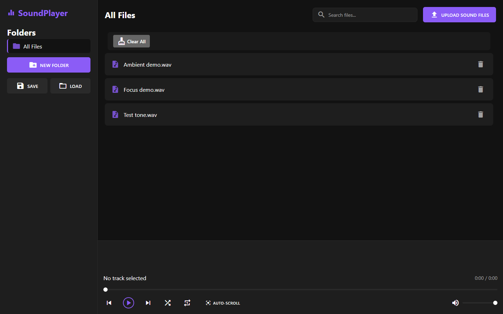

# SoundPlayer 🎵

[](https://opensource.org/licenses/Apache-2.0)
[](https://www.electronjs.org/)
[](https://nodejs.org/)

SoundPlayer is a sleek, modern audio player that brings your music to life with stunning spectrum visualization.

This cross-platform application offers intuitive playlist management, smart folder organization, and essential playback features like shuffle and repeat.

With its beautiful dark theme interface and responsive design, SoundPlayer makes managing and enjoying your music collection a breeze.

Whether you're organizing your library, creating custom playlists, or just enjoying your favorite tracks with crystal-clear audio playback, SoundPlayer provides all the tools you need in an elegant, easy-to-use package.



## Version 1.1.1

Renamed the repository and desktop branding to SoundPlayer. Existing library profiles and installer identity are preserved.

## Version 1.1 improvements

Library startup now restores metadata only and reads audio when selected. Existing ArrayBuffer libraries remain compatible without a destructive migration. Imports store Blobs directly, and portable ZIP exports include audio and folders without recompressing media. Audio is still copied into app storage; native file-reference mode is not included.

Restores validate metadata and audio entries, stage incoming files, and atomically replace the prior library. Invalid or cancelled restores preserve existing data. Limits: 20,000 tracks, 512 MiB per track, 2 GiB total uncompressed audio, and 5 MiB metadata. Save/load a ZIP backup before replacing a library. This version preserves app data on uninstall; older uninstallers may still delete their application data.

Volume and position persist, and tracks resume when you press Play without autoplay. Shuffle avoids repeats within a cycle; Previous follows session playback history. Media-session actions support system playback controls where available. JSZip and icon fonts are bundled for offline use. User labels are escaped, IPC senders are validated, and file access is restricted to native-dialog-selected ZIPs with atomic output replacement.

Electron and build dependencies were updated; unused FFmpeg packaging was removed. The Windows installer is unsigned unless a certificate is configured. macOS/Linux packaging remains available but was not validated in this Windows update.

### Measured library restoration

On a synthetic 64-track, 64 MiB library, three trials per version on the same Windows machine and Electron 45.2.3 runtime gave median library-state restoration of **124.1 ms before and 1.4 ms after**. Startup audio reads fell from 64 MiB/64 requests to zero. This measures the restoration step, not total startup; audio reads now happen on selection.

```bash
npm ci
npm run test:unit
npm test
node tests/benchmark.cjs 8ae4c94236752a4cb56529beea0582716e38f53f
npm run build:win
```

Integration tests use isolated temporary profiles, never your normal library. The same tests can target the packaged executable by setting `SOUNDPLAYER_EXECUTABLE` to its absolute path. The Windows CI workflow runs both development and packaged tests.

## ✨ Features

- 🎵 Audio playback with spectrum visualization
- 🔍 **Real-time search** - Find your music instantly as you type
- 📁 Folder organization for your music
- 📋 Playlist management with shuffle and repeat
- 🎯 **Auto-scroll** - Automatically scroll to the currently playing track
- 🎨 Modern dark theme interface
- 💾 Save/Load library functionality
- 🔊 Volume and seek controls
- 📱 Responsive design

## 🚀 Quick Start

### Prerequisites

- [Node.js](https://nodejs.org/) (v24 or higher)
- npm (comes with Node.js)

### Installation

#### Method 1: Download Executable (Recommended)

1. Download the appropriate file for your system:
   - Windows: `SoundPlayer-Setup.exe` (installer) or `SoundPlayer-Portable.exe`
   - macOS: `SoundPlayer.dmg`
   - Linux: `SoundPlayer.AppImage` or `soundplayer.deb`
2. Run the downloaded file
3. Start enjoying your music!

#### Method 2: Build from Source

```bash
# Clone the repository
git clone https://github.com/AntDX316/SoundPlayer.git
cd SoundPlayer

# Install dependencies
npm install

# Start the application
npm start

# Build for your platform (optional)
npm run build
```

## 📖 Usage

1. **Launch the Application**
   - Double-click the executable or run `npm start` if using source code
   - The application will open in a new window

2. **Add Music**
   - Click the "UPLOAD SOUND FILES" button
   - Select one or more audio files
   - Files will be added to your library

3. **Search Your Music**
   - Use the search bar at the top to find files instantly
   - Search is case-insensitive and searches file names
   - Click the "×" button or press Escape to clear search
   - Use `Ctrl+F` to quickly focus the search bar

4. **Organize Music**
   - Create folders using the "NEW FOLDER" button
   - Folders are automatically saved and persist between sessions (even empty folders)
   - Rename folders by clicking the edit icon next to the folder name
   - Delete folders using the delete icon (files will be moved to "All Files")
   - Use the "All Files" view to see everything
   - Click any folder to switch between different collections

5. **Playback Controls**
   - Play/Pause: Space bar or click play button
   - Next/Previous: Arrow buttons or keyboard arrows
   - Volume: Slider in bottom right
   - Seek: Progress bar below visualization

6. **Playlist Features**
   - Shuffle: Toggle shuffle mode (mutually exclusive with repeat)
   - Repeat: Toggle repeat one/all (mutually exclusive with shuffle)
   - Auto-scroll: Toggle automatic scrolling to the currently playing track (enabled by default)
   - Click tracks to play them

7. **Save/Load Library**
   - Save: Click SAVE button to store your library organization
   - Load: Click LOAD button to restore a previously saved library
   - Note: ZIP backups include audio and folder metadata

8. **Application Menu**
   - **File Menu**: Access application controls and exit options
   - **Help Menu**: View application information and credits
   - **About Dialog**: Shows version, creator info, and application details

## ⌨️ Keyboard Shortcuts

- `Space` - Play/Pause
- `→` - Next track
- `←` - Previous track
- `Delete` - Delete individual track (using delete button on file card)
- `Ctrl+F` - Focus search bar
- `Escape` - Clear search (when search bar is focused)
- `Ctrl+Q` / `Cmd+Q` - Exit application

## 🔧 Troubleshooting

### Windows
- If you get audio playback errors, ensure your default audio device is set correctly
- For file permission errors, try running as administrator

### macOS
- If the application doesn't open, check Gatekeeper settings
- For audio permission issues, grant access in System Preferences

### Linux
- If audio doesn't work, ensure ALSA/PulseAudio is installed
- For file access issues, check folder permissions

## 🤝 Contributing

Contributions are welcome! Please feel free to submit a Pull Request.

## 👨‍💻 Author

Created by **[@AntDX316](https://twitter.com/AntDX316)**

## 📄 License

This project is licensed under the Apache License 2.0 - see the [LICENSE](LICENSE) file for details.

## 🙏 Acknowledgments

- Thanks to all contributors who have helped shape SoundPlayer
- Built with [Electron](https://www.electronjs.org/)